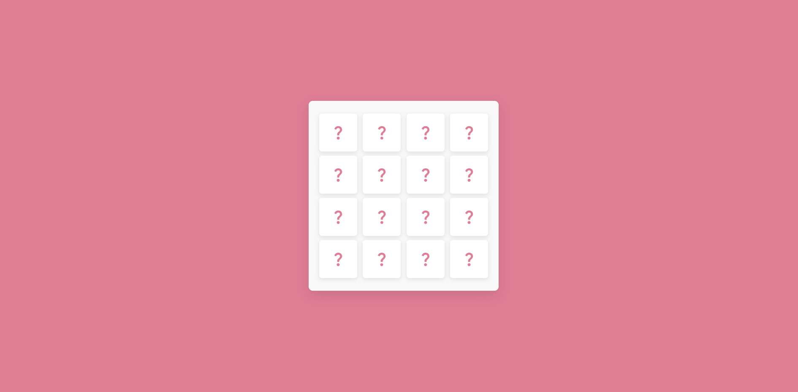
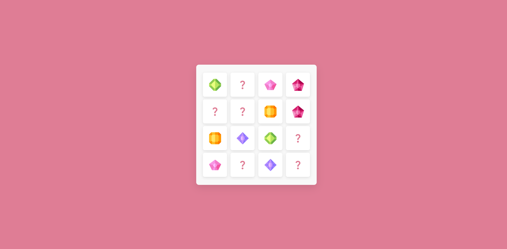

# Memory Card Game

## Live Demo

You can play the game live here: [Memory Card Game](https://aizafatimahere.github.io/Memory-Game/)

## About The Project

A simple and fun Memory Card Game built using HTML, CSS, and JavaScript. The goal is to find matching pairs of cards by flipping them over and remembering their positions.

Flip two cards at a time and try to match all the pairs with as few moves as possible. It's a small project focused on improving memory while keeping the gameplay simple and enjoyable.

## Technologies Used

- HTML
- CSS
- JavaScript

## Screenshots

  

  

